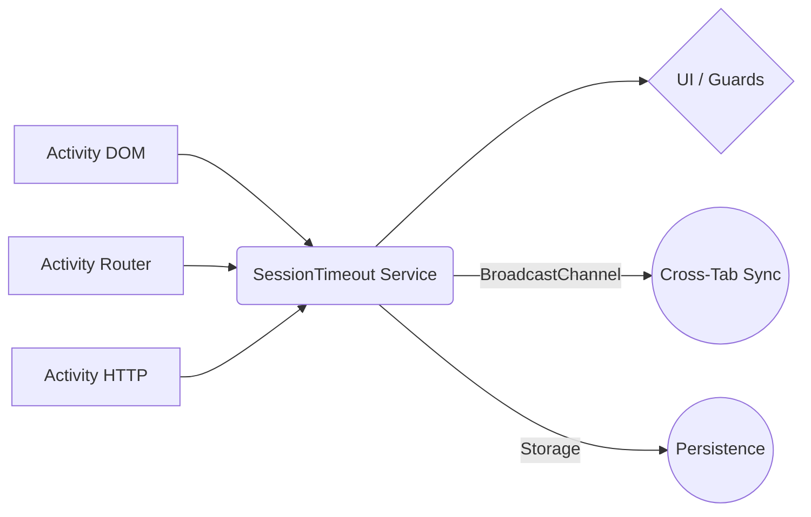

<div align="center">

# ng2-idle-timeout

[](https://www.npmjs.com/package/ng2-idle-timeout)
[](https://www.npmjs.com/package/ng2-idle-timeout)
[](https://opensource.org/licenses/MIT)
[](https://angular.io/)
[]()
[](https://github.com/prettier/prettier)

<br>

**Zoneless-friendly session timeout orchestration for Angular 16+**  
*(Verified through v20)*

<p align="center">
  <i>Crafted by <b>Codex</b> & <b>Gemini</b></i>
</p>

</div>

---

`ng2-idle-timeout` keeps every tab of your Angular application in sync while tracking user activity, coordinating leader election, and handling server-aligned countdowns—all without relying on Angular zones.

## 📑 Contents

- [Overview & Concepts](#-overview--concepts)
- [Quick Start](#-quick-start)
- [Configuration Guide](#-configuration-guide)
- [Service & API Reference](#-service--api-reference)
- [Recipes & Integration Guides](#-recipes--integration-guides)
- [Additional Resources](#-additional-resources)

---

## 🔮 Overview & Concepts

### What it solves
- **Unified State**: Consolidates idle detection, countdown warnings, and expiry flows across tabs/windows.
- **Resilience**: Survives reloads by persisting snapshots/config; state restores instantly.
- **Zoneless Coordination**: Uses **Leader Election** to manage shared state without Zone.js.
- **Signal-First**: Built on Angular Signals for reactive, granular updates.

### How it fits together



### Compatibility Matrix

| Package | Angular | Node | RxJS |
| :--- | :--- | :--- | :--- |
| `ng2-idle-timeout` | **16+** (tested thru 20) | >=18.13 | >=7.5 < 9 |

---

## ⚡ Quick Start

### 1. Install

```bash
npm install ng2-idle-timeout
# Or scaffold everything
ng add ng2-idle-timeout
```

### 2. Define Providers

Bundle your configuration once using `createSessionTimeoutProviders`.

```ts
// session-timeout.providers.ts
import { createSessionTimeoutProviders } from 'ng2-idle-timeout';

export const sessionTimeoutProviders = createSessionTimeoutProviders({
  storageKeyPrefix: 'app-session',
  idleGraceMs: 60_000, // 1 min idle
  countdownMs: 300_000, // 5 min countdown
  warnBeforeMs: 60_000, // Warn last 1 min
  resumeBehavior: 'autoOnServerSync',
  resetOnWarningActivity: true
});
```

### 3. Register & Start

**Standalone (`main.ts`):**

```ts
bootstrapApplication(AppComponent, {
  providers: [
    provideRouter(routes),
    provideSessionTimeout(/* config closure or imported providers */)
  ]
});
```

**Inside your App Component:**

```ts
export class AppComponent implements OnInit {
  private readonly sessionTimeout = inject(SessionTimeoutService);

  ngOnInit() {
    this.sessionTimeout.start(); // 🚀 Start the engine
  }
}
```

### 4. Display Status (Signals)

```ts
// Your component logic
protected readonly state = this.sessionTimeout.stateSignal;
protected readonly countdown = this.sessionTimeout.countdownRemainingMsSignal;
```

```html
<p>State: {{ state() }}</p>
<p>Time Left: {{ (countdown() / 1000) | number:'1.0-0' }}s</p>
```

---

## 🛠 Configuration Guide

| Key | Default | Description |
| :--- | :--- | :--- |
| `idleGraceMs` | `120s` | Time before countdown begins. |
| `countdownMs` | `3600s` | Countdown window for extension. |
| `warnBeforeMs` | `300s` | When to emit WARN events. |
| `resetOnWarningActivity` | `true` | Auto-reset on activity during warn? |
| `resumeBehavior` | `'manual'` | `'manual'` or `'autoOnServerSync'`. |
| `storageKeyPrefix` | `'ng2-idle-timeout'` | Namespace for cross-tab sync. |

> **Sync Mode Note**: This library now exclusively uses **Leader Election**. The `distributed` mode was removed in v0.3.x for better reliability.

---

## 📡 Service & API Reference

### Core Methods

| Method | Purpose |
| :--- | :--- |
| `start()` | Initialize timers & elect leader. |
| `stop()` | Reset to IDLE and clear state. |
| `extend()` | Restart the countdown (if not expired). |
| `resetIdle()` | Record activity & restart idle window. |
| `expireNow()` | Force immediate expiry. |

### Signals vs Observables

Every signal has a matching Observable.

- **State**: `stateSignal` / `state$`
- **Countdown**: `countdownRemainingMsSignal` / `countdownRemainingMs$`
- **Events**: `events$` (Stream of `Started`, `Warn`, `Extended`, etc.)

---

## 💡 Recipes

### 🛡️ Blocking Expiry Guard
Redirect users immediately when the session dies.

```ts
{
  path: 'secure',
  canActivate: [SessionExpiredGuard],
  children: [...]
}
```

### 🌍 Cross-Tab Sync
Just set the same `storageKeyPrefix`.
- **Leader Tab**: Writes state to storage.
- **Follower Tabs**: Read storage & broadcast events.
- **Result**: Logout in one tab = Logout in all tabs.

---

## 📚 Additional Resources

- **Demo App**: `npm run demo:start` (http://localhost:4200)
- **Playwright Tests**: `npm run demo:test`
- **Issues**: [GitHub Issues](https://github.com/ng2-idle-timeout)

<div align="center">
  <br>
  <sub>MIT Licensed • Happy Idling! ⏱️</sub>
</div>